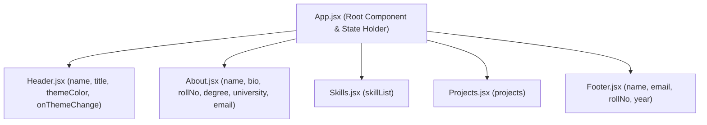

# Practical 1: Introduction to React and Component Architecture

- **Course:** Web Development Frameworks (WDF) - 5th Semester
- **Course Outcome:** CO1 (Understand and apply React component architecture)
- **Program Outcomes:** PO3 (Design/development of solutions), PO5 (Modern tool usage)
- **Student Name:** Max Patel
- **Roll Number:** 24IT070
- **Repository Name:** `task5-todoapp-maxpatel`
- **Repository URL:** [https://github.com/max7199/task5-todoapp-maxpatel.git](https://github.com/max7199/task5-todoapp-maxpatel.git)

---

## 1. Aim of the Practical

To design, develop, and test a responsive, modular **Student Portfolio** web application using **React 18** and **Vite**, demonstrating core component architecture principles:
1. Functional React components (`Header`, `About`, `Skills`, `Projects`, `Footer`).
2. JSX syntax and semantic HTML structure.
3. Props and unidirectional (parent-to-child) data flow.
4. Dynamic array rendering using JavaScript `.map()` with unique `key` attributes.
5. Inline styling driven dynamically by props (`themeColor`).
6. Component composition through a centralized root component (`App.jsx`).

---

## 2. Software and Technologies Used

| Technology / Tool | Version | Role in Project |
|---|---|---|
| **Node.js** | v24+ | JavaScript runtime for package management and script execution |
| **Vite** | 5.4.21 | Next-generation frontend build tool and lightning-fast HMR dev server |
| **React** | 18.3.1 | Declarative component-based UI library |
| **React DOM** | 18.3.1 | DOM renderer for React components |
| **JavaScript (ES6+)** | ES2022+ | Modern JS language features (destructuring, arrow functions, `.map()`) |
| **CSS3** | Modern | Flexbox, Grid, CSS custom properties, responsive breakpoints, transitions |
| **Git & GitHub** | Latest | Version control and source code repository hosting (`task5-todoapp-maxpatel` / [https://github.com/max7199/task5-todoapp-maxpatel.git](https://github.com/max7199/task5-todoapp-maxpatel.git)) |

---

## 3. Theory & Fundamental Concepts

### A. What is React?
React is an open-source JavaScript library developed by Meta for building modular, interactive user interfaces. React uses a **Virtual DOM** (a lightweight in-memory representation of the real DOM) to calculate minimal UI updates via a reconciliation algorithm, resulting in superior performance.

### B. What is Vite?
Vite is a modern build tool that significantly improves the frontend developer experience:
- It serves source code over native ES Modules (ESM) during development, eliminating bundling overhead.
- It provides instant Hot Module Replacement (HMR).
- It uses Rollup for optimized production builds.

### C. What is JSX?
JSX (JavaScript XML) is a syntax extension for JavaScript that looks similar to HTML. It allows developers to write UI markup directly within JavaScript files:
- JSX converts HTML tags into `React.createElement()` calls.
- Expressions can be embedded inside `{}` braces.
- Special attribute names must be used: `className` instead of `class`, `htmlFor` instead of `for`, and camelCase attributes like `ariaLabel` or `onClick`.

### D. Functional Components
A functional component in React is a pure or stateful JavaScript function that accepts `props` as its single argument and returns JSX:
```jsx
function Header({ name, themeColor }) {
  return (
    <header style={{ backgroundColor: themeColor }}>
      <h1>{name}'s Portfolio</h1>
    </header>
  );
}
export default Header;
```

### E. Props (Properties)
Props are read-only inputs passed from a parent component to a child component.
- **Unidirectional Data Flow:** Data strictly travels top-down (Parent -> Child).
- **Immutability:** A child component cannot modify the props it receives.
- **Destructuring:** Props can be unpacked cleanly in the function parameters: `function About({ name, bio })`.

### F. Dynamic Rendering with `.map()` and `key`
When rendering an array of data into JSX elements, JavaScript's `.map()` function transforms each data item into a component or HTML element. React requires a unique and stable `key` prop for each item to identify which items have changed, been added, or been removed during reconciliation.

---

## 4. Component Tree and Architecture



### Component Responsibility Breakdown:

1. **`App.jsx` (Root Composer):**
   - Holds centralized student information (`student` object).
   - Holds skills data (`skillsData` array) and sample projects (`projectsData` array).
   - Manages state for `themeColor` using `useState`.
   - Passes data down to child components via props.

2. **`Header.jsx` (Top Navigation & Hero Banner):**
   - Displays student name and portfolio title.
   - Houses the top navigation bar linking to `#about`, `#skills`, `#projects`, and `#contact`.
   - Receives `themeColor` via props and applies it dynamically using an inline style (`style={{ backgroundColor: themeColor }}`).
   - Contains an interactive theme switcher button palette.

3. **`About.jsx` (Student Introduction):**
   - Receives `name`, `bio`, `rollNo`, `degree`, `university`, and `email` props.
   - Uses semantic HTML (`<section>`, `<h2>`, `<article>`, cards).
   - Renders a personal bio and a structured 6-cell academic information grid.

4. **`Skills.jsx` (Dynamic Skills List):**
   - Receives `skillList` array via props.
   - Iterates through the list using `.map()` with stable unique keys (`key={skill}`).
   - Displays skills with checkmark icons and responsive CSS grid cards.

5. **`Projects.jsx` (Post-Lab Assignment - Sample Projects):**
   - Displays exactly three representative student projects.
   - Receives `projects` array via props with a built-in fallback.
   - Iterates using `.map()` with stable keys (`key={project.id}`).
   - Renders project number, project title, description, and technology tags.

6. **`Footer.jsx` (Contact & Copyright):**
   - Houses the `#contact` section targeted by the navigation menu.
   - Receives `name`, `rollNo`, `email`, and `year` through props.
   - Displays contact details without inventing fake external phone numbers or fake social accounts.
   - Displays dynamic copyright year and academic credits.

---

## 5. File Structure

```text
student-portfolio/
├── dist/                      # Production build output
├── node_modules/              # Project dependencies
├── public/                    # Static assets
├── src/
│   ├── components/
│   │   ├── Header.jsx         # Header & navigation with themeColor inline style
│   │   ├── About.jsx          # Personal bio & academic details via props
│   │   ├── Skills.jsx         # Dynamic skills rendering using .map()
│   │   ├── Projects.jsx       # Exactly 3 projects cards (Post-Lab)
│   │   └── Footer.jsx         # Contact details & copyright notice
│   ├── App.jsx                # Main composition component & state holder
│   ├── App.css                # Component styling, layouts, cards, and breakpoints
│   ├── index.css              # Design tokens, CSS variables, typography, reset
│   └── main.jsx               # React 18 DOM root rendering entry point
├── index.html                 # Single HTML host page
├── package.json               # Scripts and dependency declarations
├── vite.config.js             # Vite configuration with @vitejs/plugin-react
├── .gitignore                 # Excludes node_modules, dist, .env, and logs
└── PRACTICAL_1_README.md      # College practical documentation & Viva prep
```

---

## 6. How Props and Dynamic List Rendering Work in Code

### A. Passing and Consuming Props (App.jsx -> Header.jsx)
In `App.jsx`, state and data are defined and passed as attributes:
```jsx
// App.jsx (Parent)
const [themeColor, setThemeColor] = useState('#1e3a8a');
const student = { name: 'Max Patel', title: 'B.Tech IT Student' };

<Header
  name={student.name}
  title={student.title}
  themeColor={themeColor}
  onThemeChange={setThemeColor}
/>
```
In `Header.jsx`, props are destructured in the function argument:
```jsx
// Header.jsx (Child)
function Header({ name, title, themeColor, onThemeChange }) {
  return (
    <header className="header" style={{ backgroundColor: themeColor }}>
      <h1>{name}'s Portfolio</h1>
      <p>{title}</p>
    </header>
  );
}
```

### B. Dynamic List Rendering with `.map()` (App.jsx -> Skills.jsx)
In `App.jsx`, an array of strings is passed:
```jsx
// App.jsx
const skillsData = [
  'HTML5 & Modern CSS3',
  'JavaScript (ES6+)',
  'React.js & JSX',
  'Node.js & Express.js',
  'MongoDB & Mongoose'
];

<Skills skillList={skillsData} />
```
In `Skills.jsx`, the array is mapped into `<li>` elements:
```jsx
// Skills.jsx
function Skills({ skillList = [] }) {
  return (
    <ul className="skills-list">
      {skillList.map((skill, index) => (
        <li key={typeof skill === 'string' ? skill : `skill-${index}`} className="skill-item">
          <span className="skill-check">✓</span>
          <span className="skill-text">{skill}</span>
        </li>
      ))}
    </ul>
  );
}
```

---

## 7. Steps to Install and Run the Application

### Prerequisites:
- Node.js (v18+) and npm installed. Check with:
  ```powershell
  node -v
  npm -v
  ```

### Step 1: Open Project Directory
```powershell
cd 'D:\5THSEM WDF\PRATICAL'
# or
cd 'D:\5THSEM WDF\student-portfolio'
```

### Step 2: Install Dependencies (if not already installed)
```powershell
npm install
```

### Step 3: Run the Development Server
```powershell
npm run dev
```
Open your browser and navigate to: `http://localhost:5173/`

### Step 4: Build for Production
```powershell
npm run build
```
This produces an optimized production bundle inside `dist/`.

### Step 5: Preview the Production Build Locally
```powershell
npm run preview
```

---

## 8. Expected Output

When running `http://localhost:5173/`, the website displays:
1. **Top Header & Navigation Bar:**
   - Dark translucent top navigation bar with brand icon `💻 Max Patel`.
   - Four navigation links: `About`, `Skills`, `Projects`, `Contact`.
   - Theme color picker buttons (Deep Blue, Emerald, Purple, Dark Slate). Clicking any color updates the Header background in real time.
2. **Hero Banner:**
   - Badge: `React Portfolio • Practical 1 (CO1)`.
   - Title: `Max Patel's Portfolio`.
   - Subtitle: `B.Tech Information Technology Student`.
   - Meta tags: Gujarat, India; Charusat University; Roll No: 24IT070; Semester 5.
3. **About Me Section:**
   - Semantic student biography paragraph.
   - Structured 6-item information card grid (Full Name, Roll Number, Degree, Institution, College Email, Focus Areas).
4. **Technical Skills Section:**
   - Grid of 9 dynamic skill items rendered via `.map()` with checkmarks and hover effects.
5. **Sample Projects Section (Post-Lab):**
   - 3 project cards:
     1. *Task Management REST API* (Node.js, Express, MongoDB, Mongoose)
     2. *Daily Expense Tracker* (React, JavaScript, CSS3, Vite)
     3. *Student Performance Analytics Dashboard* (React, Chart.js, REST API, JavaScript)
6. **Footer / Contact Section:**
   - Contact details (Student Name, Roll No: 24IT070, Email, Location).
   - Academic Information (B.Tech IT, Charusat University, WDF Practical 1).
   - Portfolio details and copyright notice.

---

## 9. Testing Procedure and Verification Checklist

| Test Item | Action | Expected Result | Actual Status |
|---|---|---|---|
| **Build Validation** | Run `npm run build` | Compiles with 0 errors and generates `dist/` bundle | Passed (0 errors) |
| **Component Rendering** | Open page | All 5 components (Header, About, Skills, Projects, Footer) appear | Verified |
| **Props Passing (Name)** | Check Header & About | Shows `Max Patel` passed from `App.jsx` | Verified |
| **Props Passing (Theme)** | Click theme picker dot | Header background changes color dynamically via inline style | Verified |
| **Dynamic Skills List** | Check Skills section | 9 skills rendered from `skillsData` array via `.map()` | Verified |
| **Project Cards (3 items)**| Check Projects section | Exactly 3 project cards with title, description, and tags | Verified |
| **Navigation Anchors** | Click `#about`, `#skills`, `#projects`, `#contact` | Page scrolls smoothly to the target section | Verified |
| **Console Errors** | Inspect DevTools Console | Zero runtime errors, zero missing key warnings | Verified (Clean) |
| **Git Configuration** | Run `git status` | Clean status, `node_modules` and `dist` properly ignored | Verified |

---

## 10. Common Errors and Solutions

| # | Common Error | Cause | Solution |
|---|---|---|---|
| 1 | `Warning: Each child in a list should have a unique "key" prop` | Rendering items with `.map()` without providing a unique `key` prop | Add `key={skill}` or `key={item.id}` to the outermost element in `.map()` callback. |
| 2 | `ReferenceError: useState is not defined` | Using `useState()` without importing it | Add `import { useState } from 'react';` at the top of the file. |
| 3 | `Error: Expected "{" but found ...` | Missing quotes or improper syntax in JSX attributes | Ensure string attributes are enclosed in quotes: `className="portfolio-app"`. |
| 4 | Component not rendering | Forgot `export default ComponentName` or wrong import path | Verify default export exists and match import path: `import Header from './components/Header'`. |
| 5 | Port 5173 already in use | Another Vite process is running | Vite will automatically switch to port 5174 or kill the previous process using `Stop-Process`. |

---

## 11. Reflection on Development and Error Resolution

During implementation:
- **Single-File vs. Multi-Component Architecture:** To satisfy college practical guidelines strictly, the portfolio structure was kept clean and modular with 5 independent component files inside `src/components/`, each responsible for a single concern.
- **Dynamic List Rendering:** Used `.map()` with stable unique keys for both skills and project cards, avoiding index-only keys when stable names or IDs are available.
- **Inline Style Dynamic Update:** To demonstrate prop-driven inline styling, `Header.jsx` receives `themeColor` and applies `style={{ backgroundColor: themeColor }}` directly to the `<header>` element, with smooth CSS transition effects.

---

## 12. College Viva Questions and Answers

### Q1: What is a React component?
**Answer:** A React component is an independent, reusable piece of UI logic and markup. In modern React, components are written as JavaScript functions that accept `props` and return JSX.

### Q2: What is the difference between Props and State?
**Answer:**
- **Props (Properties):** Read-only data passed from a parent component down to a child component. Props cannot be modified by the receiving child component.
- **State:** Internal data managed within a component using hooks like `useState`. State is mutable and causes the component to re-render when updated.

### Q3: Why do we use `.map()` instead of a `for` loop to render lists in React?
**Answer:** In JSX, we can only embed expressions that evaluate to a value. The `.map()` method is an expression that returns a new array of JSX elements, whereas a `for` loop is a statement that does not return a value.

### Q4: Why is the `key` prop mandatory when rendering lists dynamically?
**Answer:** The `key` prop gives elements a stable identity so React's Virtual DOM diffing algorithm can determine which items were added, removed, or reordered without re-rendering the entire list.

### Q5: What is unidirectional data flow?
**Answer:** Unidirectional data flow means data travels in a single direction from top to bottom (from parent components to child components via props). This makes state changes predictable and easier to debug.

### Q6: What is Vite and why is it preferred over Create React App (CRA)?
**Answer:** Vite is a modern frontend build tool that uses native ES Modules during development for near-instant server start and hot module replacement, and Rollup for production bundling. CRA uses Webpack, which bundles the entire application upfront, making it much slower.

### Q7: What is JSX and can the browser run JSX directly?
**Answer:** JSX is a syntax extension for JavaScript that allows writing HTML-like code inside JavaScript. Browsers cannot execute JSX directly; a compiler like Babel or esbuild transforms JSX into standard JavaScript (`React.createElement` or JSX runtime calls).

### Q8: How is the `themeColor` prop applied in `Header.jsx`?
**Answer:** It is passed from `App.jsx` as a prop (`themeColor={themeColor}`) and applied inside `Header.jsx` using React inline styling:
`<header className="header" style={{ backgroundColor: themeColor }}>`.

### Q9: What are the three sample projects required for the post-lab assignment?
**Answer:**
1. Task Management REST API (Node.js, Express, MongoDB, Mongoose)
2. Daily Expense Tracker (React, JavaScript, CSS3, Vite)
3. Student Performance Analytics Dashboard (React, Chart.js, REST API, JavaScript)

### Q10: How do navigation links `#about`, `#skills`, `#projects`, `#contact` work without React Router?
**Answer:** They use standard HTML hash anchors. When clicked, the browser smoothly scrolls to the element with matching `id` attributes (`id="about"`, `id="skills"`, `id="projects"`, `id="contact"`), supported by `scroll-behavior: smooth` in CSS.

### Q11: What is the role of `main.jsx`?
**Answer:** `main.jsx` is the entry point of the React application. It uses `createRoot()` from `react-dom/client` to mount the root `<App />` component into the `<div id="root"></div>` DOM element inside `index.html`.

### Q12: How can this project be extended for upcoming practicals?
**Answer:** Because the project follows modular component architecture, future practicals can easily add:
- Component State and event handling (`useState`)
- Lifecycle methods and API fetching (`useEffect`)
- Multi-page routing (`react-router-dom`)
- Form validation and input management
- Global state management (Context API or Redux)
