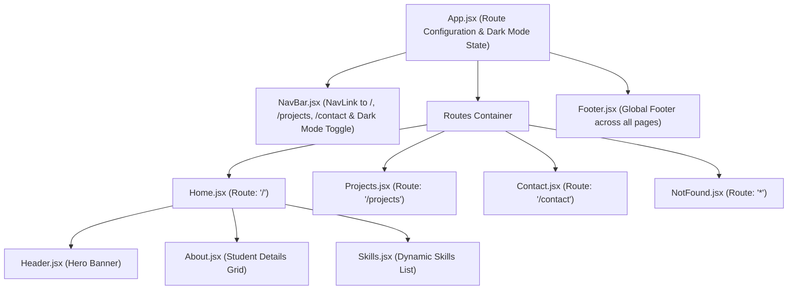

# Practical 2: React State Management and Multi-Page Navigation

- **Course:** Web Development Frameworks (WDF) - 5th Semester
- **Course Outcome:** CO1 (Understand and apply React component architecture & state management)
- **Program Outcomes:** PO3 (Design/development of solutions), PO5 (Modern tool usage)
- **Student Name:** Max Patel
- **Roll Number:** 24IT070
- **Repository Name:** `task5-todoapp-maxpatel`
- **Repository URL:** [https://github.com/max7199/task5-todoapp-maxpatel.git](https://github.com/max7199/task5-todoapp-maxpatel.git)

---

## 1. Aim of the Practical

To extend the React student portfolio application developed in Practical 1 by implementing:
1. Client-side multi-page routing using **React Router** (`react-router-dom`).
2. Three primary application routes (`/` for Home, `/projects` for Projects, and `/contact` for Contact), plus a fallback `*` route for a custom 404 Not Found page.
3. Active link styling using React Router's `NavLink` component.
4. Reactive state management using React's `useState` hook for:
   - A **controlled input form** with live character counting.
   - **Real-time message preview** reflecting keystrokes instantly.
   - A **Clear Message** reset action.
   - A **UI visibility toggle** for displaying/hiding help guidelines.
   - A **Dark/Light mode toggle** applied dynamically to the root container.

---

## 2. Course Outcomes and Program Outcomes

- **CO1:** Understand fundamental concepts of React, components, JSX, props, state management, and client-side single page navigation.
- **PO3 (Design/Development of Solutions):** Design a multi-page interactive web interface with form validation, live feedback, and error handling.
- **PO5 (Modern Tool Usage):** Utilize modern web development tools including React 18, Vite, React Router v6/v7, and Git version control.

---

## 3. Theory & Fundamental Concepts

### A. What is Client-Side Routing?
In traditional multi-page web applications (MPAs), clicking a hyperlink requests a brand new HTML document from the web server, causing the browser to flash and reload the entire page.

In a **Single Page Application (SPA)** using **React Router**, the browser loads a single HTML file (`index.html`). When a user navigates between routes, React Router intercepts the URL change using HTML5 History API (`pushState`) and dynamically swaps the active component without triggering a full page reload.

### B. Core React Router Components
- **`BrowserRouter`:** Uses HTML5 history API to keep the UI in sync with the current URL path. It must wrap the entire application tree once (in `main.jsx`).
- **`Routes`:** The parent container that examines all child `<Route>` definitions and renders the best matching branch.
- **`Route`:** Maps a URL path (e.g. `/projects`) to a React component element (e.g. `<Projects />`).
- **`Link`:** Replaces the standard HTML `<a href="...">` tag. It navigates to a new route without reloading the browser window.
- **`NavLink`:** A specialized version of `<Link>` that knows whether it is currently active. It passes an `isActive` boolean to its `className` callback function, enabling easy styling for the active page.

### C. What is React State (`useState`)?
State represents data that can change over time within a component. Unlike regular JavaScript variables, when state is modified using its updater function, React automatically re-evaluates the component function and **re-renders** the UI to reflect the updated state.

Syntax:
```jsx
const [stateValue, setStateFunction] = useState(initialValue);
```

### D. Controlled vs. Uncontrolled Components
In HTML, form inputs like `<input>` and `<textarea>` maintain their own internal state based on user typing.

In a **Controlled Component**, the input value is bound directly to React state:
```jsx
<textarea
  value={message}
  onChange={(e) => setMessage(e.target.value)}
/>
```
- **Single Source of Truth:** React state controls the current text.
- **Instant Synchronization:** Every keystroke fires `onChange`, calls `setMessage(e.target.value)`, updates state, and immediately updates any dependent UI elements (such as character count and live preview).

### E. How React Updates the UI on State Changes
1. **Trigger:** User types a character $\rightarrow$ `onChange` event fires.
2. **State Setter:** `setMessage(e.target.value)` is invoked with the new string.
3. **Re-render:** React schedules a re-render of `Contact.jsx`.
4. **Virtual DOM Diffing:** React builds a new Virtual DOM tree and compares it with the previous one.
5. **Real DOM Reconciliation:** React updates only the changed text nodes in the actual DOM (the textarea value, character count badge, and live preview paragraph).

---

## 4. Component and Route Architecture



### Route Table:

| URL Path | Rendered Component | Purpose |
|---|---|---|
| `/` | `Home.jsx` | Portfolio hero banner (`Header`), student bio (`About`), and dynamic skills list (`Skills`). |
| `/projects` | `Projects.jsx` | Distinct page displaying three sample software projects with descriptions and tech pills. |
| `/contact` | `Contact.jsx` | Controlled interactive form with `useState` message input, live preview, character counter, clear button, and help visibility toggle. |
| `*` | `NotFound.jsx` | Catch-all custom 404 page for unmatched routes with a Link back to `/`. |

---

## 5. Detailed Explanation of `useState` in Contact.jsx

Two independent `useState` variables are used in `Contact.jsx` to satisfy practical requirements:

### Variable 1: `message` (Controlled Input & Real-Time Sync)
```jsx
const [message, setMessage] = useState('');
```
- **Initial Value:** An empty string `''`.
- **Updater Function:** `setMessage`.
- **Purpose:**
  - Binds to `<textarea value={message} onChange={(e) => setMessage(e.target.value)} />`.
  - Calculates live character length via `{message.length}`.
  - Feeds the live message preview card: `{message.trim() ? message : '...'}`.
  - Cleared on clicking the Clear button via `setMessage('')`.

### Variable 2: `showHelp` (UI Visibility Toggle)
```jsx
const [showHelp, setShowHelp] = useState(false);
```
- **Initial Value:** `false` (help instructions are hidden by default).
- **Updater Function:** `setShowHelp`.
- **Purpose:**
  - When the user clicks the Help button, it triggers: `onClick={() => setShowHelp(!showHelp)}`.
  - Conditionally renders the guidance box using short-circuit evaluation:
    ```jsx
    {showHelp && <div className="help-box">...</div>}
    ```

---

## 6. Difference Between `<Link>` and HTML `<a>` Tag

| Feature | React Router `<Link>` / `<NavLink>` | Standard HTML `<a>` Tag |
|---|---|---|
| **Page Refresh** | **No refresh.** Updates components instantaneously via JavaScript. | **Full page reload.** Re-downloads HTML, scripts, and resets state. |
| **User Experience** | Smooth, app-like transition with zero screen flickering. | Visible white screen flash while browser navigates. |
| **State Preservation**| Global and parent state (e.g., dark mode toggle) is preserved. | All React state is completely wiped and re-initialized. |
| **Active Class Support**| `NavLink` automatically provides `isActive` state for styling. | Requires custom server or JavaScript logic to mark active links. |

---

## 7. Installation and Execution Commands

```powershell
# 1. Navigate to the project directory
cd 'D:\5THSEM WDF\PRATICAL'

# 2. Verify react-router-dom is installed
npm list react-router-dom

# 3. Start the Vite development server
npm run dev

# 4. Run the production build to verify zero syntax/build errors
npm run build

# 5. Preview production build locally
npm run preview
```

---

## 8. Expected Output

1. **Global Navigation Bar:**
   - Sticky top bar with brand `💻 Max Patel • Portfolio`.
   - Links: `Home`, `Projects`, `Contact`.
   - The link corresponding to the current URL receives a blue background `.active` pill.
   - Clicking `🌙 Dark` toggles dark mode across the entire application without refreshing or changing routes.
2. **Home Route (`/`):**
   - Hero header with student name, subtitle, and university badge.
   - Semantic About Me section with personal details grid.
   - Dynamic Skills section rendered from an array.
3. **Projects Route (`/projects`):**
   - Distinct page titled "My Projects".
   - 3 cards: Task Management REST API, Daily Expense Tracker, Student Performance Analytics Dashboard.
4. **Contact Route (`/contact`):**
   - Help guidelines toggle button: clicking toggles the green instructions panel.
   - Controlled message textarea: typing updates the character counter and live message preview box instantly.
   - Clear Message button: clears the input and resets character count to 0.
   - Submit button: validates input and displays confirmation alert.
5. **404 Route (e.g. `/unknown`):**
   - Displays 404 code, "Page Not Found" title, and a `Link` button to return to Home.
6. **Global Footer:**
   - Present across all pages with student contact placeholders, roll number (24IT070), and copyright notice.

---

## 9. Testing Procedure and Verification Checklist

| Test Item | Action | Expected Result | Actual Result |
|---|---|---|---|
| **Client-Side Routing** | Click `Projects` and `Contact` in navbar | URL updates to `/projects` and `/contact` with no page refresh | Verified |
| **Active Route Highlight**| Navigate to `/projects` | `Projects` link receives `.active` class with blue background | Verified |
| **Controlled Input** | Type `Hello Professor` into textarea | Value reflects in textarea and state synchronously | Verified |
| **Live Character Counter** | Type 15 characters | Badge displays `Character Count: 15` in real time | Verified |
| **Live Message Preview** | Type into textarea | Text appears simultaneously in the dashed preview box | Verified |
| **Clear Button** | Click "Clear Message" | Textarea resets to empty string, counter resets to 0 | Verified |
| **Help Toggle** | Click "Show Help Guidelines" | Green help box appears; clicking again hides it | Verified |
| **Dark/Light Mode** | Click `🌙 Dark` in navbar | Background turns dark, cards switch to `#1e293b`, button text becomes `☀️ Light` | Verified |
| **404 Route** | Navigate to `/random-test-page` | Custom 404 page renders with "Return to Home Page" link | Verified |
| **Production Build** | Run `npm run build` | Bundles 50 modules cleanly with 0 errors | Passed (2.28s) |

---

## 10. Common Errors and Solutions

| # | Common Error | Cause | Solution |
|---|---|---|---|
| 1 | `Error: useRoutes() may be used only in the context of a <Router> component` | `<Routes>` was used inside a component that is not wrapped in `<BrowserRouter>` | Wrap `<App />` inside `<BrowserRouter>` in `main.jsx`. |
| 2 | Multiple `BrowserRouter` warnings | Wrapping both `main.jsx` and `App.jsx` in `<BrowserRouter>` | Keep `<BrowserRouter>` strictly in `main.jsx` and remove it from `App.jsx`. |
| 3 | Page reloads when clicking links | Using standard HTML `<a href="/projects">` instead of React Router `<NavLink to="/projects">` | Replace all internal anchors with `<Link>` or `<NavLink>` from `react-router-dom`. |
| 4 | Input not updating when typed into | Providing a `value` prop without an `onChange` handler in input | Add `onChange={(e) => setMessage(e.target.value)}`. |
| 5 | Clear button does not clear text | Mutating state directly (`message = ''`) instead of calling setter | Always use the state setter function: `setMessage('')`. |

---

## 11. Reflection on Development and Error Resolution

During implementation:
- **Preservation of Practical 1 Architecture:** Rather than discarding components created in Practical 1, `Header`, `About`, `Skills`, and `Footer` were seamlessly integrated into the new routing structure under `Home.jsx` and `App.jsx`.
- **Router Version Compatibility:** The project uses `react-router-dom` v7 in backward-compatible v6 mode (`BrowserRouter`, `Routes`, `Route`, `NavLink`), ensuring clean execution without deprecated APIs.
- **Dark Mode Implementation:** Managed at the root level in `App.jsx` using `const [darkMode, setDarkMode] = useState(false)` so theme persistence is completely independent of route transitions.

---

## 12. College Viva Questions and Answers

### Q1: What is the main purpose of React Router?
**Answer:** React Router enables client-side navigation in a Single Page Application (SPA), allowing users to switch between different page views without triggering a full browser reload.

### Q2: What is the difference between `<BrowserRouter>`, `<Routes>`, and `<Route>`?
**Answer:**
- `<BrowserRouter>` is the top-level provider that manages URL history.
- `<Routes>` is the container that matches the current browser URL against child route paths.
- `<Route>` pairs a specific path (e.g. `/contact`) with a component element (`<Contact />`).

### Q3: Why should we use `<Link>` or `<NavLink>` instead of `<a href>`?
**Answer:** The standard `<a href>` tag causes the browser to reload the entire web page, losing all React state. `<Link>` intercepts navigation using the HTML5 History API, updating only the relevant components with zero page reload.

### Q4: What extra capability does `<NavLink>` provide over `<Link>`?
**Answer:** `<NavLink>` provides built-in awareness of whether its URL path matches the active route. It passes an `isActive` boolean flag to its `className` function, making it easy to highlight active navigation links.

### Q5: What is a controlled input in React?
**Answer:** A controlled input is an input element whose value is bound to and controlled by React component state (`value={message}`) and whose updates are handled via an `onChange` callback calling the state setter function (`setMessage(e.target.value)`).

### Q6: What happens under the hood when `setMessage` is called?
**Answer:** React schedules a state update, triggers a re-render of the component, computes the difference (diff) between the old and new Virtual DOMs, and applies minimal updates to the actual DOM.

### Q7: Explain the two `useState` hooks used in `Contact.jsx`.
**Answer:**
1. `const [message, setMessage] = useState('')`: Stores the string entered by the user in the textarea, synchronizing the live character count and live message preview.
2. `const [showHelp, setShowHelp] = useState(false)`: A boolean flag toggled by the Help button to display or hide the form guidelines box.

### Q8: What does the `*` route path signify in `<Route path="*" element={<NotFound />} />`?
**Answer:** The asterisk `*` is a wildcard that matches any URL that did not match any of the preceding routes (`/`, `/projects`, `/contact`). It is used to render a custom 404 Not Found page.

### Q9: How was the dark/light mode toggle implemented?
**Answer:** It uses `const [darkMode, setDarkMode] = useState(false)` in `App.jsx`. When toggled, it adds the `.dark-mode` CSS class to the root container `div`, which inverts background and text colors via stylesheet rules.

### Q10: What is conditional rendering in React? Give an example from your project.
**Answer:** Conditional rendering means displaying elements based on boolean conditions. For example, `{showHelp && <div className="help-box">...</div>}` renders the help box only when `showHelp` evaluates to `true`.

### Q11: Can a child component modify props passed to it?
**Answer:** No, props are strictly read-only and immutable. If a child component needs to communicate changes back to its parent, the parent must pass down a callback function (e.g., `onToggleDarkMode`).

### Q12: How is Practical 2 structured to prepare for future practicals (e.g., Practicals 3–11)?
**Answer:** Practical 2 establishes a clean multi-page routing framework (`pages/` and `components/`). Future practicals (such as API integration with `useEffect`, form validation, or global context) can be added as dedicated page routes without disrupting the existing codebase.
