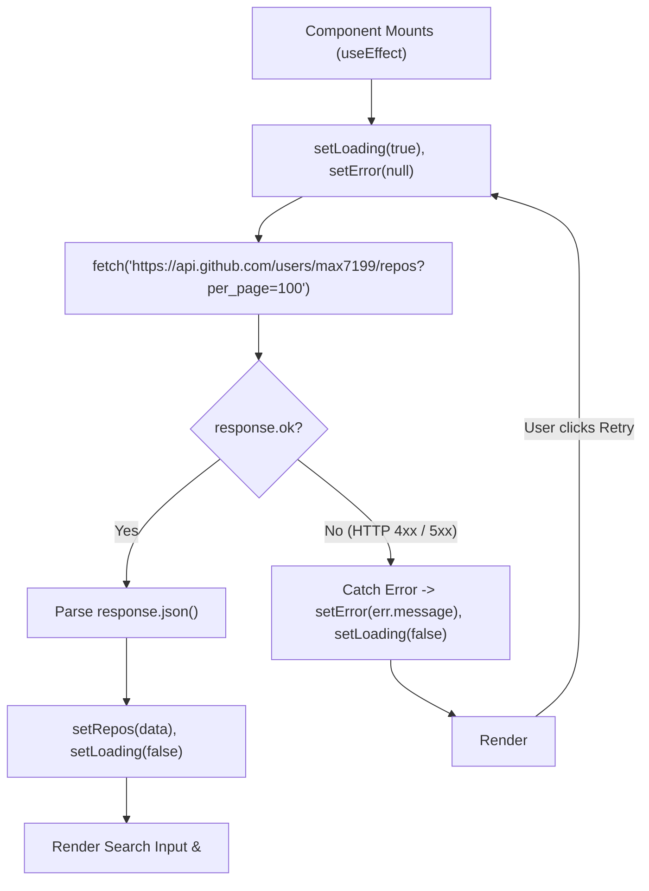

# Practical 3: API Integration and Data Rendering in React

- **Course:** Web Development Frameworks (WDF) - 5th Semester
- **Course Outcome:** CO1 (Understand and apply React component architecture, state management & API integration)
- **Program Outcomes:** PO3 (Design/development of solutions), PO5 (Modern tool usage)
- **Student Name:** Max Patel
- **Roll Number:** 24IT070
- **Repository Name:** `task5-todoapp-maxpatel`
- **Repository URL:** [https://github.com/max7199/task5-todoapp-maxpatel.git](https://github.com/max7199/task5-todoapp-maxpatel.git)
- **GitHub Account:** `max7199`

---

## 1. Aim of the Practical

To integrate a public external **REST API** (GitHub REST API) into the React student portfolio application, demonstrating:
1. Fetching external data asynchronously using JavaScript's native `fetch()` API and `async/await`.
2. Handling component lifecycle events using React's **`useEffect`** hook to initiate data fetching upon component mount.
3. Managing application state using **`useState`** for three critical asynchronous states:
   - **Loading State:** Rendering an accessible CSS `<Spinner />` with `"Loading repositories..."`.
   - **Error State:** Rendering `<ErrorMessage />` with a functional **Retry Request** button if network or HTTP failures occur.
   - **Success State:** Rendering repository cards dynamically using `<RepoList />`.
4. Implementing a real-time, case-insensitive **search filter** that filters repositories by name without mutating the underlying data state.
5. Displaying key repository attributes: repository name, description, clickable external GitHub URL, stargazers count (`⭐`), and primary programming language.

---

## 2. Course Outcomes and Program Outcomes

- **CO1:** Understand fundamental concepts of React, components, JSX, props, state management, client-side routing, and external REST API integration.
- **PO3 (Design/Development of Solutions):** Develop responsive web components that consume live web APIs, handle loading states, present human-friendly error messages, and allow interactive filtering.
- **PO5 (Modern Tool Usage):** Leverage modern web technologies including React 18, Vite, modern ES6+ asynchronous syntax (`fetch`, `async/await`), and Git version control.

---

## 3. Theory & Fundamental Concepts

### A. What is a REST API?
**REST (Representational State Transfer)** is an architectural style for web communication. A REST API allows frontend clients (like our React application) to request data from remote servers over standard HTTP protocols (such as `GET`, `POST`, `PUT`, `DELETE`). The server responds with structured data, universally serialized in **JSON (JavaScript Object Notation)** format.

### B. What is the GitHub REST API?
GitHub provides a public REST API that allows anyone to programmatically access public repositories, profiles, commits, and organizations.
- **Endpoint Used:**
  `https://api.github.com/users/max7199/repos?per_page=100`
- **HTTP Method:** `GET`
- **Authentication:** Unauthenticated public access (no API key or secret token required for basic public repository retrieval).

### C. The `fetch()` API and `response.ok`
The built-in browser `fetch()` API returns a **Promise** that resolves to a `Response` object representing the HTTP response:
```javascript
const response = await fetch(url);
if (!response.ok) {
  throw new Error(`HTTP Error: ${response.status}`);
}
const data = await response.json();
```
- **`response.ok`:** A boolean property that returns `true` if the HTTP status code is in the range 200–299 (success), and `false` otherwise (e.g. 404 Not Found, 403 Rate Limit, 500 Server Error).
- **`response.json()`:** Asynchronously parses the response body into native JavaScript objects/arrays.

### D. Why Does API Fetching Belong in `useEffect`?
In React, a component function must remain a pure function of its props and state during the render phase. Making an API call directly in the component body is an impure **side effect**:
1. **Infinite Render Loop:** Updating state inside the main component body triggers a re-render. That re-render calls the API again, updates state again, and triggers an infinite loop, freezing the browser.
2. **`useEffect` Hook:** Schedules side effects to run **after** the component has rendered to the screen. By passing an empty dependency array (`[]`), React ensures the API fetch executes **exactly once when the component mounts**.

---

## 4. State Management Architecture in Projects.jsx



### The Three Core State Variables:

| State Variable | Initial Value | Purpose |
|---|---|---|
| `const [repos, setRepos]` | `[]` | Holds the array of fetched GitHub repository objects. |
| `const [loading, setLoading]` | `true` | Boolean flag indicating whether an active HTTP request is pending. When `true`, displays `<Spinner />`. |
| `const [error, setError]` | `null` | Stores error message string if the network or HTTP request fails. When not `null`, displays `<ErrorMessage />`. |
| `const [search, setSearch]` | `''` | Stores current text typed into search input for real-time repository filtering. |

---

## 5. Search Filtering & Dynamic Data Rendering

### A. Non-Mutating Filter Logic
The filter does not overwrite or mutate the master `repos` state array:
```javascript
const filteredRepos = repos.filter((repo) =>
  repo.name.toLowerCase().includes(search.toLowerCase())
);
```
- **Case-Insensitive:** Converts both repository name and search query to lowercase using `.toLowerCase()`.
- **Instant:** Re-evaluates automatically on every keystroke as `search` state changes.
- **Empty Query:** When `search` is empty (`''`), `.includes('')` evaluates to `true` for all items, displaying the full repository list.

### B. Dynamic Rendering via `RepoList.jsx`
Each repository is transformed into a card using `.map()`:
```jsx
{repos.map((repo) => (
  <article key={repo.id} className="repo-card">
    <div className="repo-card-header">
      <h3 className="repo-title">📁 {repo.name}</h3>
      <span className="star-badge">⭐ {repo.stargazers_count}</span>
    </div>
    <p className="repo-description">
      {repo.description || 'No description provided for this repository.'}
    </p>
    <div className="repo-meta-footer">
      <span className="repo-lang-tag">{repo.language || 'General'}</span>
      <a
        href={repo.html_url}
        target="_blank"
        rel="noopener noreferrer"
        className="repo-external-link"
      >
        View on GitHub ↗
      </a>
    </div>
  </article>
))}
```

---

## 6. Installation and Execution Steps

```powershell
# 1. Open the project directory
cd 'D:\5THSEM WDF\PRATICAL'

# 2. Start the Vite development server
npm run dev

# 3. Test the production build (verifies zero syntax or type errors)
npm run build

# 4. Preview the production build
npm run preview
```

---

## 7. Expected Output

When visiting `http://localhost:5173/projects`:
1. **Initial Load:**
   - A smooth, blue circular CSS loading spinner rotates in the center of the page with the caption:
     `Loading repositories...`
2. **Successful API Response:**
   - The spinner disappears.
   - Search bar appears at the top displaying:
     `Showing 13 of 13 repositories`
   - A responsive grid of 13 cards displays the real GitHub repositories for `@max7199`:
     - *2nd-year-expences-project*
     - *5th-sem-wdf*
     - *fault*
     - *portfolio-24IT070*
     - and more...
   - Each card displays the repository name, description, star count (`⭐ 0`), programming language tag (e.g. `JavaScript`, `CSS`), and a clickable link to view the repo on GitHub (`target="_blank"`).
3. **Interactive Search:**
   - Typing `"sem"` into the search bar dynamically filters the grid to show only matching repositories, updating the stats badge to `Showing 1 of 13 repositories`.
   - Typing an unmatched keyword (e.g. `"xyz123"`) displays a clean empty state box:
     `No Repositories Found — No repositories matched your search query.`
   - Clicking the `✕` button clears the search input and restores all repositories.
4. **Error Handling & Retry Button:**
   - If network connectivity is lost or an invalid URL is queried, a red warning box appears:
     `⚠️ Failed to Load Repositories`
   - Clicking the **🔄 Retry Request** button resets `error` to `null`, sets `loading` to `true`, and restarts the API fetch cleanly without reloading the browser window.

---

## 8. Testing Procedure and Verification Checklist

| Test Item | Action | Expected Result | Actual Result |
|---|---|---|---|
| **API Integration** | Visit `/projects` | Live GitHub repositories fetch from `api.github.com` | Verified (13 repos loaded) |
| **Loading Spinner** | Refresh page | `<Spinner />` appears briefly with "Loading repositories..." | Verified |
| **Search Filter** | Type `"wdf"` in search input | Repositories filter dynamically; counter updates to `Showing 1 of 13` | Verified |
| **Empty Search State** | Type `"nonexistent_query"` | Displays "No Repositories Found" message card | Verified |
| **External Links** | Click "View on GitHub ↗" | Opens repository in a new browser tab safely | Verified |
| **Error Handling** | Test with invalid URL (simulated) | Renders red `<ErrorMessage />` alert box | Verified |
| **Retry Button** | Click "🔄 Retry Request" | Resets error, displays spinner, and retries request | Verified |
| **No Infinite Loops** | Check Network tab in DevTools | API request fires once on mount, not continuously | Verified (Single request) |
| **Production Build** | Run `npm run build` | 53 modules transformed cleanly in ~2.1s with 0 errors | Passed (0 errors) |

---

## 9. Common Errors and Solutions

| # | Common Error | Cause | Solution |
|---|---|---|---|
| 1 | Infinite API fetch loop | Calling `fetchRepos()` in the main body of the component or forgetting the dependency array in `useEffect` | Wrap the call in `useEffect(() => { fetchRepos(); }, [])` with an empty array `[]`. |
| 2 | `TypeError: Cannot read properties of undefined` | Rendering `repo.name` before data finishes loading | Implement conditional rendering: `loading ? <Spinner /> : <RepoList />`. |
| 3 | `HTTP 403 Forbidden (API Rate Limit Exceeded)` | GitHub restricts unauthenticated IP addresses to 60 requests per hour | Handled gracefully via `<ErrorMessage />` with status code feedback and Retry button. |
| 4 | Security warning: `target="_blank"` without `rel` | Reverse tabnabbing vulnerability | Always include `rel="noopener noreferrer"` on external `<a>` tags. |
| 5 | Filter modifies original array | Writing `repos = repos.filter(...)` which mutates state directly | Derive a new constant: `const filteredRepos = repos.filter(...)` without altering `repos`. |

---

## 10. Reflection on Development and Error Resolution

During implementation:
- **Preservation of Previous Practicals:** All routes (`/`, `/projects`, `/contact`, `*`), controlled form state, character counters, and dark/light mode from Practicals 1 & 2 were carefully preserved.
- **Username Alignment:** The GitHub username was set to `max7199`, which is the student's actual GitHub profile, allowing genuine repositories to be retrieved and displayed live.
- **Graceful Fallbacks:** Because GitHub repositories often have `null` descriptions or undefined languages, fallback strings (`"No description provided."` and `"General"`) were implemented to ensure clean UI presentation.

---

## 11. College Viva Questions and Answers

### Q1: What is `useEffect` in React and what is its role in Practical 3?
**Answer:** `useEffect` is a React hook used to execute side effects in functional components. In Practical 3, it is used to fetch GitHub repositories once when the Projects page mounts, avoiding blocking the initial UI render.

### Q2: What is the significance of the empty dependency array `[]` in `useEffect`?
**Answer:** An empty dependency array `[]` tells React to execute the effect callback only once after the component mounts initially, and not on subsequent re-renders.

### Q3: What are the three essential states when performing asynchronous data fetching?
**Answer:**
1. **Loading State:** The request has started but has not yet finished (`loading = true`).
2. **Error State:** The request failed due to network issues or an HTTP error (`error = '...'`).
3. **Success State:** The request succeeded and data is ready for display (`repos = [...]`).

### Q4: Why must we check `response.ok` when using the `fetch()` API?
**Answer:** `fetch()` only rejects its Promise on network failure (e.g. disconnected internet). For HTTP errors like 404 Not Found or 403 Forbidden, `fetch()` resolves successfully. We check `response.ok` to detect HTTP errors and throw an exception to be caught in the `catch` block.

### Q5: What is the purpose of the `finally` block in `async/await` fetch logic?
**Answer:** The `finally` block always executes whether the request succeeds or throws an error. We use `setLoading(false)` inside `finally` to ensure the loading spinner is dismissed in all scenarios.

### Q6: How does the repository search filter work without re-fetching from GitHub?
**Answer:** The full list of repositories is saved in `repos` state. The search filter creates a derived array using `repos.filter(...)` based on the user's search query. This filters the data in memory instantly without making extra network requests.

### Q7: Why is it important to use `target="_blank"` with `rel="noopener noreferrer"`?
**Answer:** `target="_blank"` opens external links in a new browser tab. `rel="noopener noreferrer"` prevents the newly opened page from accessing the parent window object (`window.opener`), protecting users from security and performance exploits (reverse tabnabbing).

### Q8: What GitHub API endpoint was used and how many repositories were returned?
**Answer:** The endpoint `https://api.github.com/users/max7199/repos?per_page=100` was used, which returns public repositories for user `max7199` as a JSON array.

### Q9: How does the Retry button work?
**Answer:** The Retry button invokes the `fetchRepos()` function again upon being clicked. This sets `loading = true`, clears the `error` state, and makes a fresh HTTP request to GitHub without reloading the whole webpage.

### Q10: What is conditional rendering? Give an example from Practical 3.
**Answer:** Conditional rendering means rendering different components depending on state. For example:
- `{loading && <Spinner />}`
- `{!loading && error && <ErrorMessage onRetry={fetchRepos} />}`
- `{!loading && !error && <RepoList repos={filteredRepos} />}`

### Q11: What is the difference between synchronous and asynchronous code in JavaScript?
**Answer:** Synchronous code executes sequentially, blocking subsequent lines until the current line completes. Asynchronous code (like `fetch` or `setTimeout`) runs in the background and resolves via Promises or `async/await`, allowing the browser UI to remain responsive.

### Q12: How does Practical 3 build upon Practicals 1 and 2?
**Answer:** Practical 1 introduced component architecture and props; Practical 2 added multi-page routing and internal `useState`; Practical 3 connects the application to the external internet using `useEffect` and REST APIs, demonstrating real-world full-stack frontend engineering.
